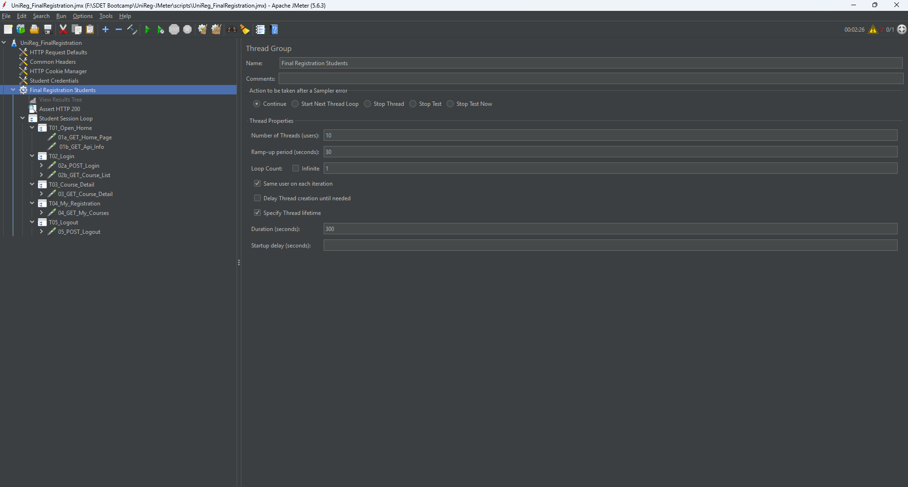
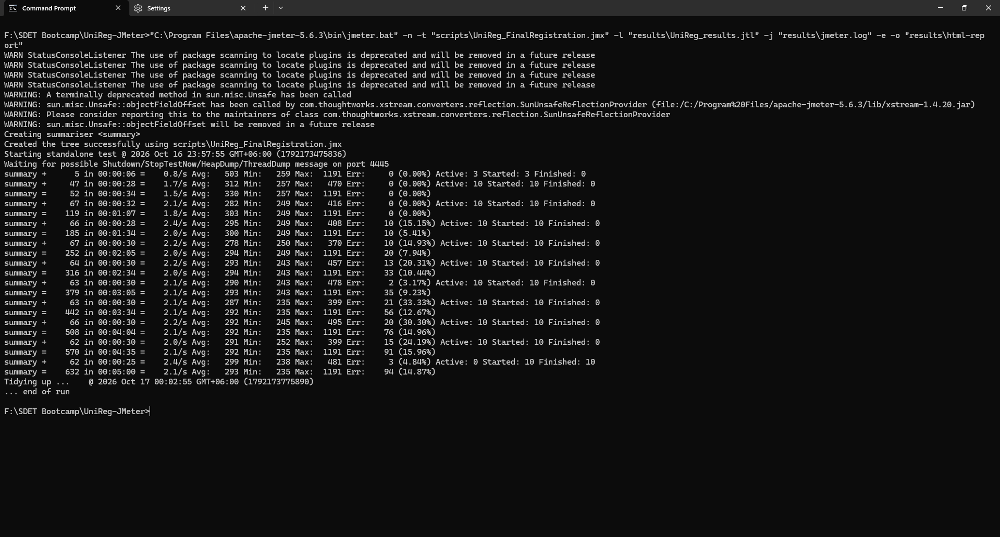

# 🎓 UniReg Cloud – JMeter Performance Testing

[](https://jmeter.apache.org/)
[](https://jmeter.apache.org/download_jmeter.cgi)
[](#-run-in-non-gui-mode)
[](#-execution-evidence)
[](docs/root-cause-analysis.md)
[](https://uni-reg-cloud.vercel.app/)

> A performance testing case study of a multi-tenant university registration platform, covering realistic load scripting, correlation, assertions, non-GUI execution, and a root cause analysis of session failures under load.

## 📋 Overview

UniReg Cloud is a SaaS registration system that serves three universities (35,000 students) from one shared backend. This project load-tests the **final registration journey**, the most critical moment of the semester, when seats are limited and thousands of students log in within minutes.

The test plan simulates real students: each virtual user logs in with its own account, picks a course from its own university's catalogue, pauses between clicks like a human, and verifies every response. When the run showed a high error rate, the results were investigated with report analysis and an isolation experiment until the cause was narrowed down.

## 🎯 Business Context

- Final registration opens at a fixed time and seats are **first come, first served**
- In the previous semester the portal **slowed down and showed error pages** during the rush
- Students of one university were affected by the rush at another
- The platform **adds servers automatically** when load rises

### 📏 Requirements Under Test

| ID | Requirement | Target |
|---|---|---|
| R2 | Page requests (login, search, enroll) respond quickly | 95% within **3 s** |
| R3 | Requests rarely fail during a registration window | Error rate **< 1%** |

## 🧪 Performance Engineering Highlights

- End-to-end user journey grouped into **Transaction Controllers** for page-level timing
- **Bearer token correlation** extracted from the login response with a JSON Extractor
- **Tenant-aware dynamic data**: course ID picked at random from the student's own course list
- **CSV-driven parameterization** with 10 students across 3 universities
- **Session pinning** so each virtual user keeps one account for the whole test
- **Layered assertions** to prevent false "green" results
- **Realistic think time** of 5–10 s before every user click
- **Non-GUI execution** with `.jtl` results and the JMeter HTML dashboard
- **Root cause analysis** backed by evidence, with clear limits of what the test can prove

## 🔄 User Journey

```text
Open Home Page
  -> GET /  +  GET /api/info
Log In
  -> POST /api/login            capture token
  -> GET /api/courses           capture random courseId (own university)
Open Course Detail
  -> GET /api/courses/{courseId}
Open My Registration
  -> GET /api/my-courses
Log Out
  -> POST /api/logout
  -> repeat for the whole session
```

## 🏗️ Test Plan Architecture

```text
UniReg_FinalRegistration
|-- HTTP Request Defaults        https, uni-reg-cloud.vercel.app, timeouts 10 s / 30 s
|-- Common Headers               Content-Type, Accept
|-- HTTP Cookie Manager
|-- Student Credentials          CSV Data Set Config -> data/users.csv
`-- Final Registration Students  10 users, 30 s ramp-up, 300 s duration
    |-- Assert HTTP 200          applies to every request
    `-- Student Session Loop     infinite, same account per user
        |-- T01_Open_Home
        |-- T02_Login            Extract Token, Assert Token Present, Extract Course ID
        |-- T03_Course_Detail    Assert Correct Course
        |-- T04_My_Registration  Assert Valid JSON
        `-- T05_Logout
```



## ✅ Assertion Strategy

| Validation layer | Assertion | Catches |
|---|---|---|
| Protocol | Response code equals `200` on every request | Server errors, redirects, `503` busy responses |
| Authentication | Login response contains `"token"` | Failed logins that still return `200` |
| Data correctness | Course detail contains the requested `${courseId}` | Wrong or cross-tenant data under load |
| Response integrity | My registration is valid JSON (`$` exists) | HTML error pages, broken responses |

## 🔗 Correlation and Runtime Variables

| Variable | Source | Used by |
|---|---|---|
| `studentId`, `password` | `data/users.csv` | Login request body |
| `token` | JSON Extractor `$.token` on login | `Authorization: Bearer ${token}` header |
| `courseId` | JSON Extractor `$[*].id`, random match | Course detail path and assertion |

Default values `TOKEN_NOT_FOUND` and `COURSE_NOT_FOUND` make failed extractions easy to spot in results.

## ⚙️ Load Profile

| Setting | Value | Reason |
|---|---|---|
| Virtual users | **10** | One per available test account; shared demo environment, so a baseline test rather than full production load |
| Ramp-up | **30 s** | One student every 3 s for a gradual warm-up |
| Duration | **300 s** | Typical length of a student's registration session |
| Think time | **5–10 s** | Uniform Random Timer, matches the observed pause between clicks |

```text
Users
 10 |        ________________________________________
    |      /
  5 |    /
    |  /
  0 |/____________________________________________________ time
    0 s    30 s                                     300 s
     ramp-up              steady state
```

## 📁 Project Structure

```text
.
|-- test-plans/
|   `-- UniReg_FinalRegistration.jmx
|       `-- JMeter test plan (final configuration)
|-- data/
|   `-- users.csv
|       `-- 10 demo student accounts from 3 universities
|-- results/
|   |-- results_run1/
|   |   `-- Run 1: baseline, before the session fix (.jtl + log)
|   `-- results_run2/
|       `-- Run 2: after session pinning, final run (.jtl + log)
|-- docs/
|   |-- root-cause-analysis.md
|   |   `-- Full investigation with evidence
|   `-- images/
|       `-- Test plan, CLI output, report and diagnostic screenshots
|-- .gitignore
`-- README.md
```

## ⚙️ Prerequisites

- Java 8 or later
- Apache JMeter 5.6 or later
- Internet access to `https://uni-reg-cloud.vercel.app`

## 🚀 Run in GUI (debug)

1. Open `test-plans/UniReg_FinalRegistration.jmx` in JMeter.
2. Enable **View Results Tree**.
3. Set **Number of Threads** to `1` for a quick functional check.
4. Start the test and inspect requests, responses, and assertion results.

> Use the GUI only for building and debugging. Run load tests in non-GUI mode.

## 🧰 Run in Non-GUI Mode

From the repository root:

```bash
jmeter -n -t test-plans/UniReg_FinalRegistration.jmx \
  -l results/new-run/UniReg_results.jtl \
  -j results/new-run/jmeter.log \
  -e -o results/new-run/html-report
```

On Windows with a full JMeter path:

```cmd
"C:\Program Files\apache-jmeter-5.6.3\bin\jmeter.bat" -n -t "test-plans\UniReg_FinalRegistration.jmx" -l "results\new-run\UniReg_results.jtl" -j "results\new-run\jmeter.log" -e -o "results\new-run\html-report"
```

| Flag | Purpose |
|---|---|
| `-n` | Non-GUI mode |
| `-t` | Test plan file |
| `-l` | Results file (`.jtl`) |
| `-j` | JMeter log file |
| `-e -o` | Generate the HTML dashboard into an empty folder |

Open `results/new-run/html-report/index.html` in a browser to view the dashboard.

## 📑 Regenerate the HTML Report

HTML dashboards are not committed (they are ignored by Git) because they can be rebuilt from the raw `.jtl` results at any time, without running the test again:

```bash
jmeter -g results/results_run2/UniReg_results.jtl -o report-run2
```

| Flag | Purpose |
|---|---|
| `-g` | Build a report from an existing `.jtl` file |
| `-o` | Output folder for the dashboard (must be empty or new) |

Open `report-run2/index.html` in a browser.

## 📊 Execution Evidence

Final run (Run 2): 10 users, 5 minutes.

| Metric | Result |
|---|---:|
| HTTP requests | 632 |
| Throughput | 2.11 req/s |
| Average response time | 293 ms |
| Median | 281 ms |
| 90th percentile | 351 ms |
| **95th percentile** | **376 ms** |
| 99th percentile | 466 ms |
| Max | 1,191 ms |
| Error rate | 14.87% (90 × 401, 4 × 404) |

### Page-level response times (95th percentile)

| Step | p95 | R2 (< 3 s) |
|---|---:|:---:|
| T01 Open Home | 738 ms | ✅ |
| T02 Login | 709 ms | ✅ |
| T03 Course Detail | 334 ms | ✅ |
| T04 My Registration | 379 ms | ✅ |
| T05 Logout | 402 ms | ✅ |

### Run comparison

| Run | Change | Error rate |
|---|---|---:|
| Run 1 – baseline | – | 18.92% |
| Run 2 – session pinning | One account per virtual user | 14.87% (0% in the first minute) |
| Diagnostic – 1 user | No thread collisions possible | 1 of 5 loops failed |



### Requirement verdict

| Requirement | Result | Verdict |
|---|---|:---:|
| R2 – 95% within 3 s | p95 376 ms, slowest page 738 ms | ✅ Pass |
| R3 – error rate < 1% | 14.87% | ❌ Fail |

## 🔍 Key Finding: Session Invalidation Under Load

Response time is **not** the problem: the server stayed around 300 ms for the whole run. The failures are **401 Unauthorized** responses on sessions that were valid moments earlier.

- Login never failed (0%)
- Errors grew with time since login: course list 6.7% → course detail 25.6% → my courses 34.5%
- Fixing an account collision in the test design removed all errors in the first minute
- A **1-user isolation run** still lost its token mid-session, ruling out the script

Two causes remain, which cannot be separated from the client side:

1. Other clients using the same shared demo accounts
2. Sessions held in the memory of serverless instances and lost when the platform scales, which would log students out exactly during the registration rush

📄 Full investigation with screenshots: **[docs/root-cause-analysis.md](docs/root-cause-analysis.md)**

## 💡 Recommendations

- Provide dedicated test accounts per tester to measure R3 accurately
- Store sessions in a shared store or use stateless tokens, so scaling does not log users out
- Log token invalidation events with a reason
- Return specific errors such as "session expired" or "signed in elsewhere" instead of a generic `unauthorized`

## 📈 Roadmap

- [x] Baseline load test of the final registration journey
- [x] Root cause analysis of session errors
- [ ] Spike test for the registration-opening rush
- [ ] Multi-tenant isolation test (one university under load, another browsing)
- [ ] Publish the HTML dashboard with GitHub Pages
- [ ] Run in CI with a quality gate on p95 and error rate

## 🔒 Security and Maintenance Notes

- The accounts in `data/users.csv` are public demo accounts for a test deployment.
- Never commit production credentials or live tokens.
- Tokens are extracted at runtime and are never stored in the test plan.
- `html-report/` folders are ignored by Git and can be regenerated from any `.jtl` file.
- Keep the load within the agreed limit when testing a shared environment.

## 💼 Project Context

This is a case study based on a training scenario and a demo deployment of the application. It focuses on performance engineering with Apache JMeter: workload modelling, correlation, parameterization, assertions, non-GUI execution, HTML reporting, and evidence-based root cause analysis.

## 🎓 What I Learned

- Correlating dynamic tokens and building tenant-aware test data
- Using assertions so that "green" really means "correct"
- Reading a JMeter dashboard to form a hypothesis, then testing it with an isolation experiment
- Separating what a client-side test can prove from what needs server-side evidence

## 👨‍💻 Author

**Tawsif Ahmed**  
SQA Engineer | Performance Testing | Apache JMeter

[](https://github.com/tawsif5001)
[](https://www.linkedin.com/in/tawsifahmed50/)