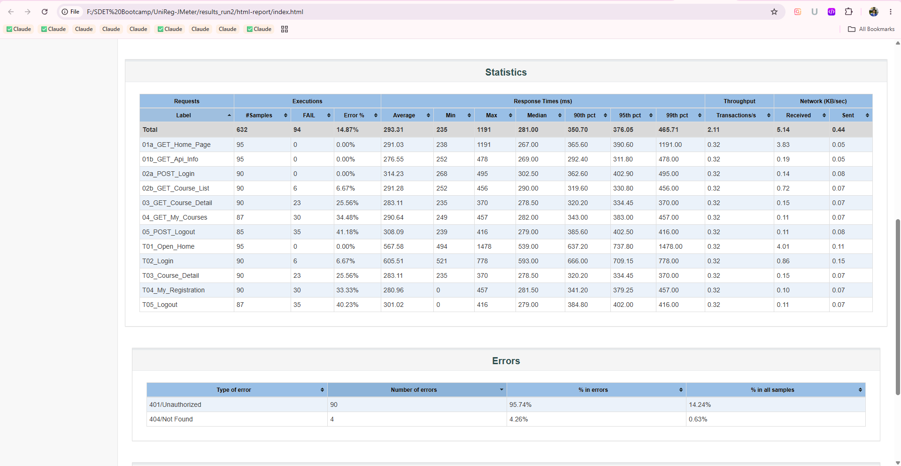
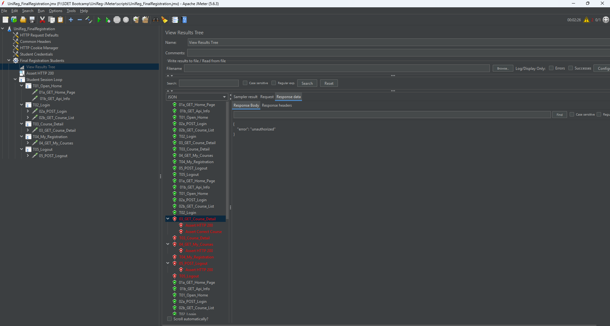
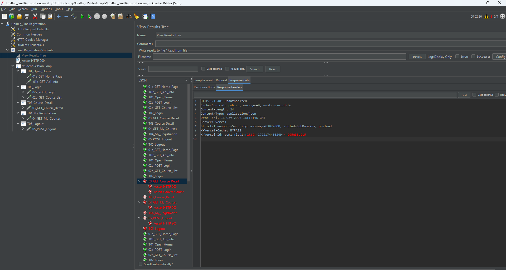
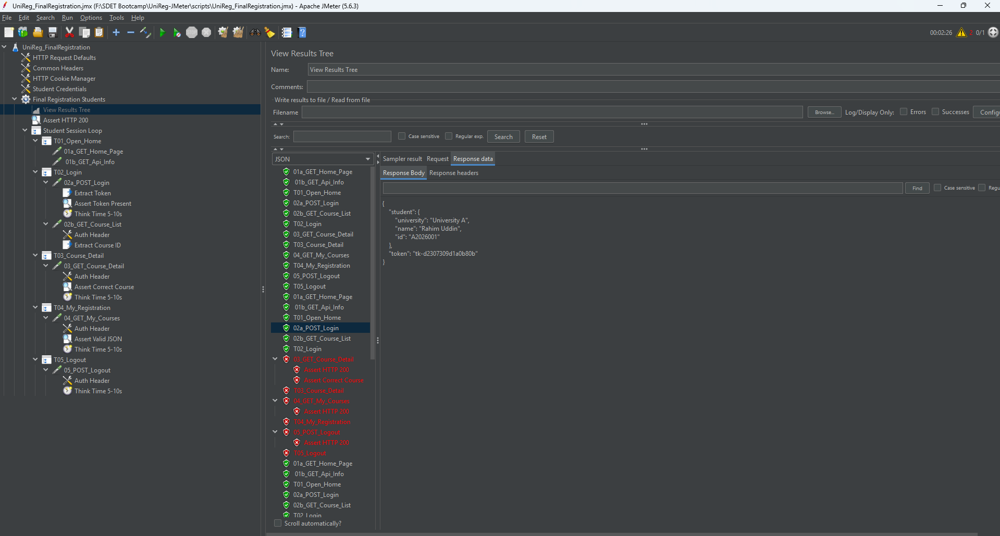

# 🔍 Root Cause Analysis: Session Errors Under Load

[](../README.md)
[](#-4-conclusion)
[](#-4-conclusion)

> Under a 10-user load, 14–19% of requests failed with **401 Unauthorized**, while response times stayed around 300 ms. This document shows how the cause was narrowed down step by step, with evidence at each stage.

## 📋 Summary

| Stage | Users | Error rate | Outcome |
|---|---:|---:|---|
| Run 1 – baseline | 10 | 18.92% | Account collision in test design found |
| Run 2 – session pinning | 10 | 14.87% | Collision fixed, 0% errors in first minute, a second cause remained |
| Diagnostic – isolation | 1 | 1 of 5 loops | Script ruled out; tokens invalidated on the server side |

## 🔄 Investigation Flow

```text
High error rate (18.92%)
  -> Read HTML report: only 401s, login never fails, errors grow with session age
  -> Hypothesis A: threads share accounts (CSV row per iteration)
  -> Fix: pin one account per virtual user
  -> Run 2: first minute 0%, but 401s return later
  -> Hypothesis B/C: something outside the test invalidates tokens
  -> Isolation run with 1 user: token still lost mid-session
  -> Conclusion: script correct, cause is server side or shared environment
```

## 1️⃣ First Observation – Run 1 (18.92% errors)

| Request | Time after login | Error rate |
|---|---|---:|
| Login | – | **0%** |
| Course list | right after | 8.7% |
| Course detail | ~7 s | 35.2% |
| My courses | ~15 s | **50.6%** |
| Logout | ~22 s | 43.4% |

### 🧠 What the data says

- **Login never failed**, so the server accepted logins without trouble
- **98% of errors were 401 Unauthorized**; the rest were 404s caused by them
- **The longer a session lasted, the more likely it was to fail**
- With 3 users there were no errors; they started when more users joined
- Response time stayed around 300 ms, so the server was **not overloaded**

### 💡 Hypothesis A

The portal allows **one active session per student**. The CSV Data Set Config gives each iteration a new row, so two virtual users could log in with the same account at the same time, and the newer login invalidated the older token.

```text
User 1: login as A2026003 -> token X -> browsing...
User 7: login as A2026003 -> token Y   (server invalidates token X)
User 1: request with token X -> 401
```

## 2️⃣ Fix and Re-test – Run 2 (14.87% errors)

### 🔧 Change

Thread Group loop count set to **1**, with a **Loop Controller** around the journey. Each virtual user reads one CSV row at the start and keeps that account for the whole test.

```text
Before:  Thread Group (loop infinite)      -> new account every iteration
After:   Thread Group (loop 1)             -> one account per user
           `-- Loop Controller (infinite)  -> same account, repeated journey
```


### 📊 Result

- The first minute had **0% errors with all 10 users active** (Run 1 had ~20% in the same period). **Hypothesis A was correct** and the fix worked.
- After the first minute, 401 errors came back at random rates (3% to 33% per 30 s).
- The same pattern remained: login 0%, errors growing with time since login (course list 6.7%, course detail 25.6%, my courses 34.5%).
- Error types: **90 × 401 (95.7%)** and **4 × 404 (4.3%)**.



### 🔗 Cascading failures

The 404s were not a separate problem:

```text
Course list -> 401 -> no course list returned
  -> Extract Course ID finds nothing -> courseId = COURSE_NOT_FOUND
  -> GET /api/courses/COURSE_NOT_FOUND -> 404
```

The default value `COURSE_NOT_FOUND` made this chain easy to trace.

➡️ **A second cause remained.**

## 3️⃣ Isolation Experiment – 1 User, 150 s

### 🎯 Why one user

With a single virtual user, **no collision between threads is possible**. If tokens are still lost, the cause is outside the test script.



| Loop | Login | Course list | Course detail | My courses | Logout |
|---|:---:|:---:|:---:|:---:|:---:|
| 1 | ✅ | ✅ | ✅ | ✅ | ✅ |
| 2 | ✅ | ✅ | ❌ | ❌ | ❌ |
| 3 | ✅ | ✅ | ✅ | ✅ | ✅ |
| 4 | ✅ | ✅ | ✅ | ✅ | ✅ |

- In loop 2, login and course list **succeeded with the new token**. After the 5–10 s think time, every request returned 401.
- Both `Assert HTTP 200` and `Assert Correct Course` caught the failure.



- The response was a generic `{"error":"unauthorized"}` from **`Server: Vercel`**.



- The failing loop logged in with the **same account** as the passing loops (`A2026001`), so session pinning worked.

## 4️⃣ Conclusion

✅ **The test script is correct.**

A valid token is invalidated **during** the session, while the test is idle in think time. Two causes are possible and cannot be separated from the client side:

| Possible cause | Explanation | Evidence that fits |
|---|---|---|
| **Shared accounts** | Other clients log in with the same public demo accounts, which invalidates our sessions | Random, bursty error rate unrelated to our own load |
| **Serverless session storage** | Sessions held in the memory of a serverless instance are lost when a new instance starts or an old one stops | `Server: Vercel`; errors began after the first minute of load; the platform adds servers when load rises |

The second cause would log students out **exactly during the registration rush**, which is when the platform scales up.

> Confirming which one requires server-side logs. Stating this clearly is part of the result: the test proves where the problem is **not**, and points to where to look next.

## 💡 Recommendations

| Recommendation | Why |
|---|---|
| Dedicated test accounts per tester | Measure the error rate (R3) without interference |
| Store sessions in a shared store, or use stateless tokens | Scaling must not log users out |
| Log token invalidation events with a reason | Makes this kind of failure easy to diagnose |
| Return specific errors ("session expired", "signed in elsewhere") | Better for users and for debugging |

## 🎓 Lessons Learned

- A green result only means HTTP success; **assertions and correct test data** are what make it meaningful
- The **error pattern over time** (more errors the longer a session lived) pointed to the cause before any change was made
- An **isolation experiment** with one user separated script problems from environment problems
- Stating clearly **what the test cannot prove** is part of a good analysis

---

⬅️ [Back to README](../README.md)